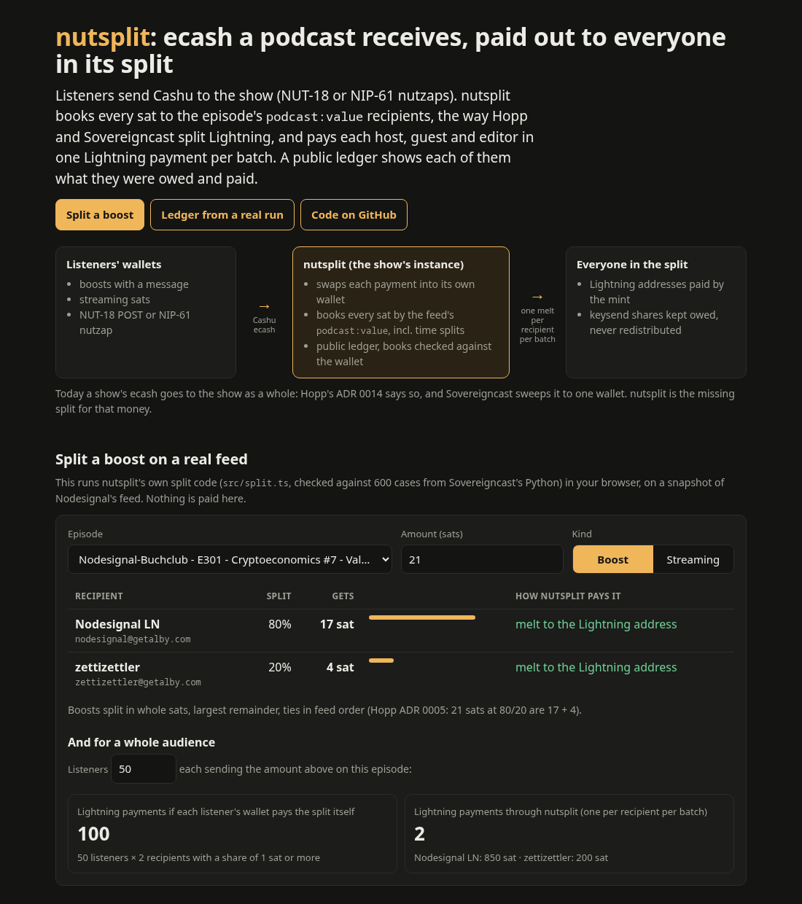
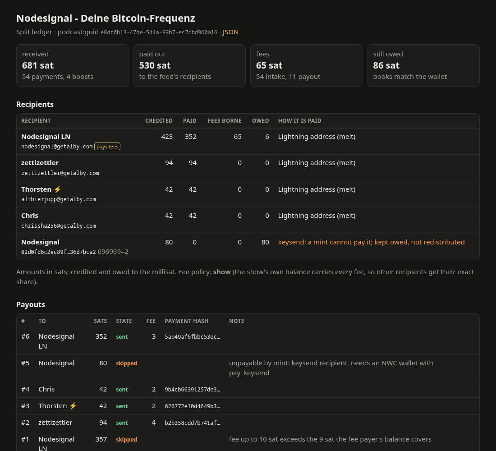

# nutsplit

[](https://github.com/apeirs/nutsplit/actions/workflows/ci.yml)
**[Live demo](https://apeirs.github.io/nutsplit/)** · Nut November, Value4Value track · MIT

**Ecash that reaches a podcast, paid out to everyone in its `podcast:value` split, not just the show.**
Listeners send Cashu (a NUT-18 payment or a NIP-61 nutzap); nutsplit books every sat to the
episode's split recipients with Hopp's and Sovereigncast's rules and pays each of them in one
Lightning payment per batch, with a public ledger of what was booked, paid and still owed.

[](https://apeirs.github.io/nutsplit/)

**Try it in a minute**

- [Split a boost in your browser](https://apeirs.github.io/nutsplit/#try): nutsplit's own split code on
  a snapshot of Nodesignal's feed (any episode, boost or streaming, one listener or a crowd).
- [The public ledger from a real run](https://apeirs.github.io/nutsplit/demo/ledger.html) on the test
  mint (2026-11-12): 54 payments in, 4 Lightning payouts out, books equal to the wallet.
  The [nutzap run's ledger](https://apeirs.github.io/nutsplit/demo/nutzap-ledger.html) too.
- Locally: `npm ci && npm test && node demo/run.ts` (Node 24+, test mints only, nothing real moves).

How it works: a listener's app sends ecash to the show, either as a NUT-18 payment over HTTP
(a payment request in the feed) or as a NIP-61 nutzap over Nostr. nutsplit swaps it into its own
wallet at once, books every sat to the episode's split recipients the way the feed says, and pays
each recipient in one Lightning payment (a melt) once enough has come together. A public ledger
page shows each recipient what was booked to them, what was paid and what is still owed.

All of it was written in November 2026 for the Nut November hackathon. The split and LNURL code is
ported from Nodesignal's Sovereigncast (MIT, see License). Test mints only so far; see
"What is not done".

## Why

Ecash payments to a show today pay the show's instance, not the people in its split. Hopp's
own architecture record says so:

> A channel pays **the show's instance**, not the `podcast:value` recipients — no split happens.
>
> — [Hopp ADR 0014, Streaming sats: accrual and settlement](https://gitlab.com/nodesignal/hopp/-/blob/main/docs/adr/0014-streaming-accrual-and-settlement.md)

That is why the ADR puts Lightning first ("Lightning splits first — they honour the
podcaster's split") and has the app tell listeners that ecash "pays the show's instance as a
whole, not the individual recipients". Sovereigncast's ecash code (`ecash.py`) is the same:
received ecash is redeemed into the instance's wallet and swept to one wallet. Its split
logic exists only for Lightning (`community.py` `_split_recipients`).

nutsplit closes that gap. It also changes the economics: a listener's wallet that splits
a 5-sat tick 80/20 has to make two Lightning payments of 4 and 1 sat. nutsplit makes one
payment per recipient per batch, for all listeners together.

## The rules it follows

These are Hopp's and Sovereigncast's rules, kept on purpose so all three agree:

- **Same split as Sovereigncast.** `src/split.ts` is a port of `_split_recipients` and
  `_resolve_v4v_value`: fee recipients take their percentage off the top, the rest by
  weight, largest remainder, ties in feed order, value-time-splits by playback position.
  The tests compare it with 600 cases generated by running Sovereigncast's own Python.
- **Whole sats for boosts, millisats for streaming.** A 21-sat boost at 80/20 is 17 + 4
  (ADR 0005). Streaming accrues to the millisat and pays whole sats; the rest carries.
- **Fees never come out of another recipient's share.** By default the show's own balance
  (the channel-level recipient) pays every fee, so a guest gets exactly their share.
  `--fee-policy recipient` makes each payout carry its own fee instead.
- **An unpayable share is skipped and shown, never redistributed.** Keysend (`node`)
  recipients cannot be paid by a mint; their balance stays owed and visible.
- **Journal before paying.** A payout is written as `unknown`, with its amount taken off
  the recipient's balance, before the mint is asked to pay (Hopp audit M-09).
- **An unknown outcome is never paid again.** Only the mint's own record settles it: the
  melt quote's state (NUT-05) and the input proofs' state (NUT-07). If the mint never
  answered, the payout is released only after a grace period, and only after its input
  proofs have been swapped, so a request still in transit cannot spend them later.
- **The invoice must ask for exactly the share** (Hopp M-04/M-06), and the mint's melt
  quote must agree. LNURL bounds are reported, never nudged. LUD-12 comment cut to
  `commentAllowed`; `no_memo` when the provider takes none; LUD-18 name only.

## Quickstart

Node 24+ (built and tested on Node 26; TypeScript runs directly, no build step).

```bash
npm ci
npm test            # 87 tests, no network (one relay on 127.0.0.1)
node demo/run.ts    # the end-to-end demo below; needs network to the two test mints
node demo/nutzap.ts # the nutzap demo (see "Nutzaps"); same test mints, a local relay
```

Run it for a show:

```bash
node bin/nutsplit.ts serve --feed https://example.com/feed.xml --mint https://testnut.cashu.space \
  --public-url https://split.example.com --threshold 210 --settle-every 300
node bin/nutsplit.ts feed-line --public-url https://split.example.com --podcast-guid <podcast:guid>
node bin/nutsplit.ts settle --feed … --mint … --force     # the daily or episode-end cutoff
node bin/nutsplit.ts pay --creq creqA… --mint https://testnut.cashu.space --fund 100 \
  --sats 21 --episode <item guid> --msg "Danke!"          # a test listener
```

State (SQLite ledger, wallet seed) lives in `./data`. While every configured mint is a test
mint, nutsplit refuses to contact a real Lightning-address provider: an LNURL callback
creates an invoice in a stranger's account. `--lnurl-map addr=url` points an address at a
stand-in.

## HTTP

| Endpoint | What |
|---|---|
| `POST /pay/<podcast_guid>?episode=<item guid>&action=stream&ts=<s>` | NUT-18 payload in. `action=stream` as in CASHU_STREAMING.md, nothing for a boost. `episode` and `ts` choose the split; without them the channel block applies. Answers with Sovereigncast's table: `untrusted_mint` + `accepted_mints`, `already_redeemed` (409), `already_spent`, `amount_too_small`, `unsupported_unit`, `invalid_payload`, `unavailable` (503); plus `no_value_block` when the feed names no recipients (the listener keeps the sats). 10 requests/min per IP by default. |
| `GET /creq/<podcast_guid>` | The NUT-18 request and the `<podcast:txt purpose="cashu">` line for the feed. |
| `GET /ledger/<podcast_guid>` | The public ledger, HTML (light and dark) or JSON (`?format=json`), with an ETag. |
| `GET /shows/<podcast_guid>/ecash` | `{"ecash": {"nut18": "creqA…", "split_settlement": true, …}}`, the capability shape of Listener API v1. With nutzaps on, also `"nutzap": {"npub", "p2pk_pubkey", "relays", "mints"}`. |

The feed record is CASHU_STREAMING.md Route B as proposed there: no amount, not
single-use, unit `sat`, one `post` transport, no mint list (the app learns it from
`untrusted_mint`). Sovereigncast lists that line as "proposed, not implemented"; this is a
working reference for it. Passing `episode` and `ts` in the POST URL's query is nutsplit's
addition.

## Nutzaps (NIP-61)

CASHU_STREAMING.md's Route A: the feed names the show's Nostr identity, an app reads the
show's `kind:10019`, locks ecash to the key it lists (NUT-11 P2PK) and publishes a
`kind:9321` to the show's relays. nutsplit subscribes to those relays, redeems each nutzap
with its own key and books it exactly like a NUT-18 payment: same split, same fee rules,
same ledger. Relays hold a nutzap while nutsplit is offline; it catches up when it is back.

```bash
# once: nutsplit makes its nutzap key (data/nutzap.secret, 0600) and prints the kind:10019
node bin/nutsplit.ts nutzap-info --nostr-pubkey npub1… --nutzap-relay wss://relay.example \
  --mint https://testnut.cashu.space
# sign that event with the show's Nostr key and publish it (e.g. with nak), and put the
# printed <podcast:txt purpose="nostr">npub1…</podcast:txt> line in the feed. Then:
node bin/nutsplit.ts serve --feed … --mint https://testnut.cashu.space \
  --nostr-pubkey npub1… --nutzap-relay wss://relay.example [--boost-threshold 100]
```

nutsplit never holds the show's Nostr secret key. It needs the public key (nutzaps `p`-tag
it) and keeps a separate key that nutzaps are locked to, as NIP-61 requires ("MUST NOT use
the target user's main Nostr public key").

**What it checks, before the mint is ever asked** (`src/nutzap.ts`): the event id is the
hash of its content and the signature is the author's; it is a `kind:9321` that `p`-tags the
show; its `u` mint is one the show lists (the relay filter already asks only for those, by
`#u`); unit `sat`; at most 64 proofs, none over 4096 characters (refused, never shortened);
every proof locked to nutsplit's key (`wrong_lock` otherwise; multisig or HTLC locks are
`unsupported_lock`). Unlocked proofs are still taken, as Sovereigncast does, because whoever
swaps them first owns them; the ledger marks them. A `guid` or NIP-73 `podcast:guid:` tag
naming another podcast is `other_podcast`. DLEQ proofs, when present, are verified before the swap.

**Which episode, boost or stream.** `episode_guid` or a NIP-73 `i` tag
(`podcast:item:guid:…`) picks the episode; failing that, an exact `episode` title; failing
that, the channel split. `ts` selects value-time-splits. A nutzap with a listener message,
or of 100 sats or more, is a boost; anything else streams. The "Title · hh:mm:ss — "
head the Nodesignal player puts in `content` is not a message (Sovereigncast's
`_listener_message`, ported).

**Exactly once.** Each event id gets one row in the ledger, claimed atomically before the
swap, so the same event from several relays, or again after a restart, is redeemed once.
Only events with a valid signature are written down: anyone can republish a copy of a nutzap
with a broken signature, and that copy must not block the real one. The proofs also pass the
token-hash check every intake uses, so the same proofs in a second event, or in a NUT-18
POST, are booked once. Every event ends in one state, shown on the ledger page and in its
JSON with the reason:

| State | Meaning |
|---|---|
| `redeemed` | swapped and booked (with the credit id) |
| `rejected` | failed a check above; the mint was not asked |
| `duplicate` | its proofs were already booked under another credit |
| `spent` | its proofs were spent before nutsplit asked: not ours to book |
| `retry` | the mint did not answer; retried after 1, 2, 4 … minutes (at most 6 h) |
| `unknown` | the swap may have happened but was not booked (crash, or an answer lost and then "spent" on retry); a NUT-09 restore would tell |

On start, an event left half-way (`claiming`) is settled from the books and the mint: its
proofs booked means redeemed, all unspent means retry, otherwise `unknown`. The relay
subscription resumes from the newest event seen minus an hour (relays deliver late) and
reconnects with backoff.

### Nutzap demo

`node demo/nutzap.ts`, run 2026-11-08 on `testnut.cashu.space` with throwaway keys made for
the run (in `demo/out/nutzap/`, not in git, never printed) and a relay on 127.0.0.1
(`test/local-relay.ts`); nothing is published to a public relay. The listener side reads
the show's `kind:10019` from the relay and locks its ecash to the key it names, as a NIP-61
app would.

```
Listener's app read the kind:10019: lock to 0209e61b3c4f5a…, mint https://testnut.cashu.space
Published 15 kind:9321 events in 2.5 s: a 21-sat boost with a message, 10 streaming ticks of 5 sat (player head only), a silent 100 sat on E300,
  one locked to someone else's key, the boost again, the boost's proofs in a new event, and one naming another mint.

What nutsplit did with each event it received:
  b4d352c165… boost 21     redeemed  credit #1
  56e51380ca… 5 sat        redeemed  credit #2
  …            (the other eight ticks the same, credits #3 to #11)
  94ad858c3e… 100 sat      redeemed  credit #12
  e9a44f9077… wrong key    rejected  wrong_lock
  3065cfe051… same proofs  duplicate proofs already booked as credit 1
  4bbf42d76d… other mint   not delivered (the relay filters #u: nutsplit never sees other mints)
  the boost was delivered twice: redeemed, seen
  the other-mint event handed to nutsplit directly: rejected (untrusted_mint: https://testnut.cashudevkit.org), mint not contacted
Restart: the relay re-sent 14 events (since = newest seen − 1 h); new credits: 0.

Booked: 12 credits, 2 boosts + 10 streaming, rail nip61, sender npub1ssfwkf8pm…
    21 sat boost on Nodesignal-Buchclub - E301 "Danke für die Folge!": Nodesignal LN 17 + zettizettler 4
   100 sat boost on Nodesignal-Spezial - E300: Nodesignal LN 60 + Thorsten ⚡️ 20 + Chris 20
Settlement (episode-end cutoff):
  zettizettler       14 sat  sent     fee 2 sat
  Thorsten ⚡️        20 sat  sent     fee 2 sat
  Chris              20 sat  sent     fee 2 sat
  Nodesignal LN      96 sat  sent     fee 2 sat
Books vs wallet: owed 1000 msat, wallet 1000 msat (match); nutzaps: 12 redeemed, 2 rejected, 1 duplicate
```

The ten streaming ticks carried only the player's "Title · 00:0x:00" head, so they were
booked as streaming, not as ten boosts. The boost's message came through without the head.
One boost from an earlier run the same day is kept as a test fixture (`test/fixtures/nutzap-testnut.json`,
public events only): the tests check its signature, its lock against the `kind:10019` key and
its DLEQ proofs against testnut's published keys, offline.

## Demo

`node demo/run.ts`, run 2026-11-07 against `testnut.cashu.space` (the settler's mint) and
`testnut.cashudevkit.org` (where the recipients' stand-ins get their invoices). Both are test
mints whose Lightning is simulated. The feed is a snapshot of Nodesignal's real feed; the
four Lightning addresses involved are answered by a local LNURL stand-in, and any other
address is refused. 50 stream payments come from one test wallet standing in for 50
listeners (rate limit off for the demo).

```
Feed: Nodesignal - Deine Bitcoin-Frequenz (snapshot 2026-11-07, 331 items)
  Nodesignal-Buchclub - E301: Nodesignal LN 80% (lnaddress), zettizettler 20% (lnaddress)
  Nodesignal-Spezial - E300: Nodesignal LN 60% (lnaddress), Thorsten ⚡️ 20% (lnaddress), Chris 20% (lnaddress)
  Nodesignal-Techboost - E299: Nodesignal 80% (node), zettizettler 20% (lnaddress)
LNURL stand-in on 127.0.0.1:39535 for 4 of the feed's Lightning addresses; every other address is refused.
nutsplit on http://127.0.0.1:39481, accepting https://testnut.cashu.space. Feed record it generates:
  <podcast:txt purpose="cashu">creqAo2F0gaNhdGRwb3N0YWF4P2h0dHA6Ly8xMjcuMC4wLjE6Mzk0ODEvcGF5L2U4ZGYwYjEzLTQ3ZGUtNTQ0YS05OWI3LWVjN2NiZDk2MGExNmFngGF1Y3NhdGFkeCNOb2Rlc2lnbmFsIC0gRGVpbmUgQml0Y29pbi1GcmVxdWVueg==</podcast:txt>

A payment from https://testnut.cashudevkit.org: HTTP 400 {"success":false,"error":"untrusted_mint","accepted_mints":["https://testnut.cashu.space"]}
50 stream payments of 5 sat on E301 + 4 boosts (21 and 100 on E301, 210 on E300, 100 on E299) POSTed in 14.2 s.
  the 21-sat boost was booked as: Nodesignal LN 17 + zettizettler 4 sat
  the 100-sat boost: Nodesignal LN 80 + zettizettler 20 sat

Settlement pass, threshold 100 sat:
  zettizettler       94 sat  waiting   (owed 94000 msat, below 100 sat)
  Thorsten ⚡️        42 sat  waiting   (owed 42000 msat, below 100 sat)
  Chris              42 sat  waiting   (owed 42000 msat, below 100 sat)
  Nodesignal         80 sat  waiting   (owed 80000 msat, below 100 sat)
  Nodesignal LN     346 sat  sent     fee 4 sat
Episode-end cutoff (pay every whole sat still owed):
  zettizettler       94 sat  sent     fee 2 sat
  Thorsten ⚡️        42 sat  sent     fee 2 sat
  Chris              42 sat  sent     fee 2 sat
  Nodesignal         80 sat  skipped   (unpayable by mint: keysend recipient, needs an NWC wallet with pay_keysend)
  Nodesignal LN      10 sat  sent     fee 2 sat

What the LNURL stand-ins were asked for (one invoice per recipient per batch):
  nodesignal     349 sat  not used  comment: nutsplit: Nodesignal · E301, E300 · 3 boosts, 50 stream payments · "Danke für die Folge!" "Valido, ergo sum" "18 Jahre Bitcoin, Prost"
  nodesignal     346 sat  paid      comment: nutsplit: Nodesignal · E301, E300 · 3 boosts, 50 stream payments · "Danke für die Folge!" "Valido, ergo sum" "18 Jahre Bitcoin, Prost"
  zettizettler    94 sat  paid      comment: nutsplit: Nodesignal · E301, E299 · 3 boosts, 50 stream payments · "Danke für die Folge!" "Valido, ergo sum" "Gemischter Satz"
  altbierjupp     42 sat  paid      comment: nutsplit: Nodesignal · E300 · 1 boost · "18 Jahre Bitcoin, Prost"
  chrissha256     42 sat  paid      comment: nutsplit: Nodesignal · E300 · 1 boost · "18 Jahre Bitcoin, Prost"
  nodesignal      10 sat  paid      comment: nutsplit: Nodesignal · remainder of earlier payments
  ("not used": the show's first invoice, asked again smaller once the mint's real fee reserve was known)

Ledger (http://127.0.0.1:39481/ledger/e8df0b13-47de-544a-99b7-ec7cbd960a16):
  recipient         credited  paid  fees     owed  paid by
  Nodesignal LN        423.0   356    66    1.000  melt to Lightning address
  zettizettler          94.0    94     0    0.000  melt to Lightning address
  Thorsten ⚡️           42.0    42     0    0.000  melt to Lightning address
  Chris                 42.0    42     0    0.000  melt to Lightning address
  Nodesignal            80.0     0     0   80.000  keysend: unpayable by mint, kept owed
  received 681 sat in 54 payments; paid out 534 sat in 5 payouts; fees: 54 sat intake (one swap per payment), 12 sat payout
  books vs wallet: owed 81000 msat, wallet 81000 msat (match)
Payouts:
  #6 Nodesignal LN    10 sat sent   fee 2 sat  hash 52e9dad0339520be…  preimage none (test mint returns none)
  #4 Chris            42 sat sent   fee 2 sat  hash 23423242c57be19f…  preimage none (test mint returns none)
  #3 Thorsten ⚡️      42 sat sent   fee 2 sat  hash 5ce14ec6549d5874…  preimage none (test mint returns none)
  #2 zettizettler     94 sat sent   fee 2 sat  hash f853507bffce9c80…  preimage none (test mint returns none)
  #1 Nodesignal LN   346 sat sent   fee 4 sat  hash 35b7431dc24b00cf…  preimage none (test mint returns none)

Fee reserve a melt needs on testnut (real quotes): 1 sat → 1, 4 sat → 1, 17 sat → 1, 74 sat → 1, 230 sat → 4, 297 sat → 5
  per listener, each 5-sat tick split 80/20 is two melts (4 + 1 sat): 2 sat of reserve for 5 sat sent
  measured: three 5-sat ticks paid per listener cost 5, 6, 6 sat in fees each (two melts per tick)
  nutsplit: 5 melts for 534 sat paid, 12 sat payout fees (2.2 %), plus 1 sat intake swap per payment (54 sat)
  the 50 ticks, all fees counted: per listener ≈ 283 sat (3 measured × 50); via nutsplit 50 sat in the listener's wallet + 50 sat intake + a share of the 12 sat payout fees

Wrote demo/out/ledger.html and demo/out/ledger.json.
```

What it shows:

- The 21-sat boost on E301 is booked 17 + 4, as Hopp and Sovereigncast split it.
- 54 incoming payments became 5 Lightning payments. zettizettler's 94 sat (from E301 and
  the lnaddress share of E299) went out as one payment with one comment naming the
  episodes and carrying the boost messages.
- The guests' balances are 0 and their "fees" column is 0: the show's balance paid all 66
  sat of fees.
- The node recipient on E299 (keysend) was not paid and its 80 sat were not given to
  anyone else.
- Books equal wallet to the millisat: 81 sat owed (80 keysend + 1 sat carry), 81 sat held.
- The test mint returns no preimage, so the ledger has payment hashes but no preimages from
  this run; the preimage path is covered by the unit tests only.

The ledger page from this run is `demo/out/ledger.html` (regenerated by every run). A rerun on
2026-11-12 (same flow; that time the show's first payout waited for a fee reserve its balance could
cover, so 54 payments became 4 payouts) is published as the
[demo ledger](https://apeirs.github.io/nutsplit/demo/ledger.html), with its
[console log](https://apeirs.github.io/nutsplit/demo/run-2026-11-12.txt):



## Fee math

Real numbers only; where they come from is stated.

**On the test mint (measured in the run above).** testnut charges 100 ppk per input proof,
so every swap or melt costs at least 1 sat in input fees.

| 50 stream ticks of 5 sat, split 80/20 | Fees |
|---|---|
| Each listener pays each recipient directly: two melts per tick (4 + 1 sat), cashu-ts's default `send` then melt | 5–6 sat per tick, measured on three ticks; about 283 sat for 50 |
| Through nutsplit | 50 sat of swaps in the listener's wallet (to make 5-sat amounts) + 50 sat intake swaps + part of the 12 sat payout fees for all 534 sat paid |

The payout side cost 12 sat for 534 sat paid (2.2 %): small batches on a 100-ppk mint. The
largest cost here is the 1-sat swap per incoming payment, which is why CASHU_STREAMING.md
asks apps to post every few minutes rather than every minute; nutsplit cannot batch what
the app sends one sat-handful at a time.

**On mainnet mints (quotes, not payments).** Melt quotes fetched on 2026-11-07 for 21, 100
and 1000-sat invoices from minibits, macadamia and coinos asked for fee reserves of
2, 2 and 10 sat: max(2 sat, 1 %). Their input fees were between 0 and 150 ppk. A reserve
is what the wallet must put up; unused reserve comes back as change, so the fee actually
paid can be lower. With a 2-sat floor per melt, a 21-sat boost split three ways from a
listener's wallet needs about 6 sat of reserve; a recipient paid once per 210 sat by
nutsplit needs 2 sat of reserve (1 %). nutsplit has not been run against a mainnet mint.

## Files

| | |
|---|---|
| `src/split.ts` | split math (Sovereigncast port, Hopp H-02 fix), recipient classification and keys |
| `src/feed.ts` | `podcast:value`, `valueTimeSplit`, `podcast:guid`, `podcast:txt` from RSS |
| `src/accrue.ts` | credit → shares, fee payer |
| `src/ledger.ts` | SQLite: credits, msat entries, payout journal, proofs, NUT-13 counters, `reconcile()` |
| `src/intake.ts`, `src/server.ts` | NUT-18 intake and the HTTP endpoints |
| `src/settle.ts` | batching, LNURL, melt, unknown-outcome resolution |
| `src/lnurl.ts`, `src/bolt11.ts` | LNURL-pay (Sovereigncast port), invoice amount check |
| `src/mint.ts` | the mint interface and its cashu-ts 4.13 implementation |
| `src/creq.ts`, `src/report.ts`, `src/listener.ts` | feed record, ledger page, test listener |
| `src/nostr.ts` | NIP-01 events (hash, verify, sign), npub, a reconnecting relay subscription |
| `src/nutzap.ts`, `src/nutzap-intake.ts` | NIP-61: kind:10019, nutzap checks and attribution; exactly-once redemption, recovery, the relay loop |
| `test/local-relay.ts` | a NIP-01 relay on 127.0.0.1 for the tests and the nutzap demo |
| `docs/sovereigncast-integration.md` | how this maps onto Sovereigncast's `ecash.py` |
| `site/` | the [demo page](https://apeirs.github.io/nutsplit/): split playground (`src/split.ts` built by `npm run site`) and the ledger pages of a real run |

## What is not done

- **Mainnet.** Only test mints have been used. Nothing here has moved real money.
- **Nutzaps** have run against testnut and a local relay only, not a public relay. nutsplit
  does not publish the `kind:10019` (it holds no Nostr secret key; `nutzap-info` prints it
  for the show to sign) and does not publish NIP-61 `kind:7376` redemption events, which
  are authored by that same key; its record of what was redeemed is the ledger. A rejected
  nutzap stays rejected: proofs locked to the show's key on a mint it does not list, or for
  another podcast, are not redeemed. One show per nutzap key, like one process per show.
  `serve` and `nutzap-info` refuse a mint whose info does not claim NUT-11 (P2PK), since such
  a mint would let any reader of the public event spend the proofs; the claim is trusted.
- **Keysend recipients** are shown as unpayable by mint. Paying them through an NWC wallet
  with `pay_keysend` is designed (ADR 0005 router) but not built.
- **Spilman channel closes** are not credited yet.
- **Remote-item time splits** (music from another feed, as in Nodesignal's E243) pay the
  base block, as Sovereigncast does; the other feed's split is not fetched.
- **Recovery.** Secrets are deterministic (NUT-13) and the counters are persisted, but a
  NUT-09 restore is not implemented or tested. If the database write after an intake swap
  failed, those proofs could only be recovered that way.
- **Proof consolidation.** Many small intake proofs make later melts pay more input fees.
- **Custody.** Between receipt and payout the instance holds the other recipients' sats,
  as today's instance wallet does; nutsplit bounds it by the threshold and shows it.
- **Fee payer.** The show's channel-level recipient pays fees even on episodes where it is
  not in the split; its balance can go negative and is netted against its later income.
- The served feed is read once at start; one process per show; the rate limit is in memory.

## License

MIT. Parts of `src/split.ts` and `src/lnurl.ts` are ports of Sovereigncast code from Nodesignal's [podcasting_tools](https://gitlab.com/nodesignal/podcasting_tools) (MIT, Copyright (c) 2026 Nodesignal); both notices are in `LICENSE`.
